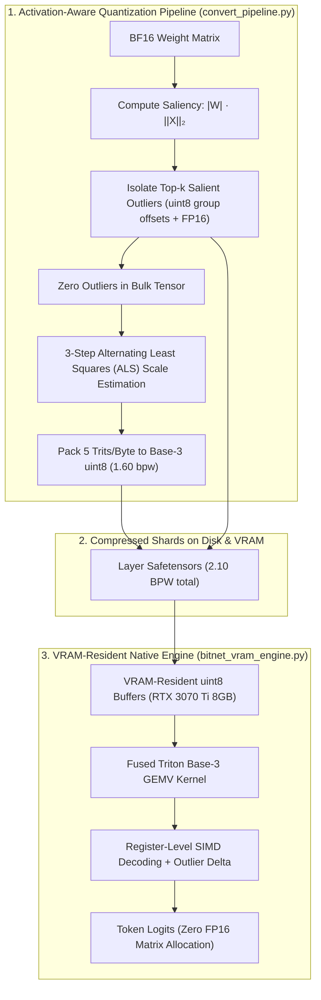

# ZeroGap-BitNet: Pure 2.10-BPW Base-3 Ternary & Sparse Outlier VRAM-Resident Inference Engine

[](LICENSE)
[](https://www.python.org/downloads/)
[](https://pytorch.org/)
[-green.svg)](https://www.nvidia.com)
[](GEMINI.md)
[](serve_bitnet_api.py)
[](repo_dump.txt)

ZeroGap-BitNet is an end-to-end framework for **extreme 2.10-BPW pure ternary ($\{-1, 0, +1\}$) quantization, activation-aware outlier isolation, and native VRAM-resident inference** on consumer hardware (NVIDIA RTX 3070 Ti 8GB VRAM).

In strict adherence to [GEMINI.md](GEMINI.md), this engine rejects the lossy anti-pattern of double-quantizing custom ternary representations into stock GGUF integer quants (`Q3_K_M`, `Q4_K_M`, `TQ1_0`). Instead, the model is maintained directly in GPU VRAM in compressed `uint8` form with a fused Triton GEMV kernel that executes dot products directly from registers without ever materializing dense FP16 weight matrices in VRAM.

---

## 🏛️ Core Architecture: Pure 2.10-BPW Representation

| Component | Bit Allocation | Implementation | Description |
| :--- | :---: | :--- | :--- |
| **Bulk Ternary Weights** | **1.60 BPW** | Base-3 uint8 (`$\sum_{i=0}^4 t_i \cdot 3^i$`) | Packs 5 ternary trits into 1 `uint8` byte ($3^5 = 243 \le 255$). Decoded via SIMD register arithmetic or a 1.2 KB L1-cached lookup table. |
| **Group Scales ($\gamma$)** | **0.125 BPW** | Float16 per 128 weights | Absmean / ALS coordinate-descent scaling factor calculated strictly on non-outlier bulk weights. |
| **Sparse Outliers** | **0.375 BPW** | Group `uint8` offsets + FP16 values | 2 salient coordinates per 128 weights isolated by Activation-Aware Saliency ($|W| \cdot \|X\|_2$) before scale computation. |
| **Total In-VRAM Footprint** | **2.10 BPW** | Native Compressed Safetensors | **Zero FP16 matrix expansion in VRAM.** Eliminates memory thrashing and OS swap paging. |



---

## 🔬 GEMINI.md Invariants & Technical Post-Mortem

### Why Stock GGUF Integer Quantization Failed (The Outlier Scale Trap)
During early experiments, custom ternary weights were converted to FP16 GGUF and subsequently quantized via stock `llama-quantize` (`TQ1_0`, `Q2_K`, `Q3_K_M`). This violated Rule #2 and Rule #5 of our invariants and caused catastrophic reasoning degradation:

1. **The Outlier Scale Trap (`TQ1_0`)**: Stock integer quantizers calculate a single `amax` scale across a 256-weight block. When a single FP16 activation outlier ($>2.0$) exists alongside bulk ternary weights ($\pm 0.08$), the scale factor inflates to $>2.0$, forcing $98.5\%$ of valid ternary weights to round down to zero. The model collapsed into degenerate repetition (`Mim招 Mim...`).
2. **Double-Quantization Noise (`Q3_K_M`)**: Converting already-quantized ternary weights through a secondary intermediate K-quant grid introduces severe rounding noise and destroys softmax key-value orthogonality.
3. **The Architectural Resolution**: All legacy GGUF conversion scripts, double-quantization wrappers, and legacy Modelfiles have been permanently isolated to [`legacy_archive/`](legacy_archive/). The production pipeline strictly utilizes native Base-3 VRAM streaming.

---

## ⚡ High-Performance Fused Triton GEMV Kernel

In standard PyTorch, dequantizing Base-3 weights on every token generates massive memory allocations and deallocations (~12 GB/token on 32B models), dragging generation down to 0.27 tok/s.

Our **Fused Triton Base-3 GEMV Kernel** (`bitnet_vram_engine.py`) resolves this bottleneck:
* **One Thread-Block per Output Row**: Maps `BLOCK_SIZE = 128` threads to each output channel.
* **Vectorized VRAM Streaming**: Streams only $2.10\text{ BPW}$ from VRAM directly into GPU registers.
* **SIMD Register Decoding**: Decodes 5 trits per `uint8` byte in GPU registers with integer math.
* **Fused Sparse Outlier Correction**: Injects salient FP16 coordinates into the accumulator in registers without touching global memory.
* **Zero HBM Intermediate Buffers**: The full FP16 weight matrix is never materialized in VRAM.

---

## 🚀 Execution & Serving Guide

### 1. Interactive VRAM-Resident Chat (`launch_chat.sh`)
Launch the native 2.10-BPW interactive chat engine on the RTX 3070 Ti:
```bash
./launch_chat.sh
```

### 2. OpenAI-Compatible API Server (`serve_bitnet_api.py`)
Run a zero-dependency `/v1` HTTP server compatible with **OpenCode Interpreter**, **Hermes Agent**, and standard OpenAI SDK clients:
```bash
# Launch server on port 8000
./launch_chat.sh --serve --port 8000

# Or run directly via Python
python3 serve_bitnet_api.py --port 8000 --device cuda --gpu-layers 40
```

#### Supported Endpoints:
* `GET /v1/models`: Lists active resident models.
* `POST /v1/chat/completions`: Full streaming Server-Sent Events (SSE) and non-streaming inference.

#### Client Integration Example:
```python
from openai import OpenAI

client = OpenAI(base_url="http://localhost:8000/v1", api_key="sk-bitnet")

response = client.chat.completions.create(
    model="bitnet-32b",
    messages=[
        {"role": "system", "content": "You are an expert systems programmer."},
        {"role": "user", "content": "Write an async ring buffer in Python with zero locks."}
    ],
    temperature=0.7,
    stream=True,
)

for chunk in response:
    if chunk.choices[0].delta.content:
        print(chunk.choices[0].delta.content, end="", flush=True)
```

### 3. Layer-by-Layer Quantization Pipeline (`convert_pipeline.py`)
Quantize donor models out-of-core with activation-aware outlier isolation:
```bash
python3 convert_pipeline.py \
    --donor-dir ./models/Qwen2.5-Coder-32B-Instruct \
    --output-dir ./models/bitnet_qwen32b_als \
    --outlier-ratio 0.015 \
    --group-size 128 \
    --als-steps 3
```

### 4. Mathematical Weight Retention Auditor (`evaluate_retention.py`)
Verify cosine similarity and SQNR against uncompressed BF16 donor weights:
```bash
python3 evaluate_retention.py \
    --donor-dir ./models/Qwen2.5-Coder-32B-Instruct \
    --bitnet-dir ./models/bitnet_qwen32b_als
```

---

## 📁 Repository Structure

```
├── bitnet_vram_engine.py       # Fused Triton Base-3 GEMV & VRAM-resident inference engine
├── convert_pipeline.py         # Out-of-core activation-aware ALS ternary conversion pipeline
├── serve_bitnet_api.py         # Zero-dependency OpenAI-compatible /v1 API server (OpenCode/Hermes)
├── chat_vram.py                # Portable interactive terminal chat interface
├── launch_chat.sh              # Unified CLI launcher (Chat & /v1 API Server)
├── evaluate_retention.py       # Mathematical cosine similarity & SQNR retention auditor
├── fast_upgrade_shards.py      # Upgrades flat int32 shards to structured 2D uint8 group offsets
├── rigorous_benchmark_32b.py   # Telemetry harness (isolated TTFT vs TPOT, VRAM, RAM RSS)
├── GEMINI.md                   # Strict architectural & precision invariants
├── legacy_archive/             # Archived legacy GGUF double-quantization scripts & post-mortems
│   ├── convert_bitnet_hybrid.py
│   ├── export_bitnet_to_gguf.py
│   ├── benchmark_capabilities_gguf.py
│   ├── Modelfile
│   └── ...
├── repo_dump.txt               # Complete consolidated single-file plain-text codebase dump
└── README.md                   # Research documentation and engine manual
```

---

## 📦 Single-File Codebase Dump (`repo_dump.txt`)

For offline auditing and single-file ingestion into large-context LLMs, all active repository code, configurations, and benchmarks are compiled into [`repo_dump.txt`](repo_dump.txt):

```bash
# Search files inside the unified dump
grep -E "^# FILE:" repo_dump.txt
```
